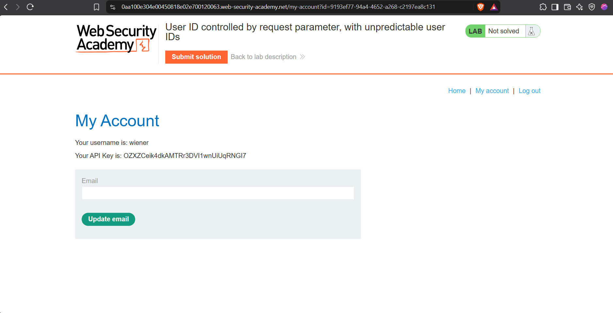
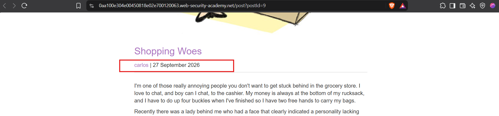
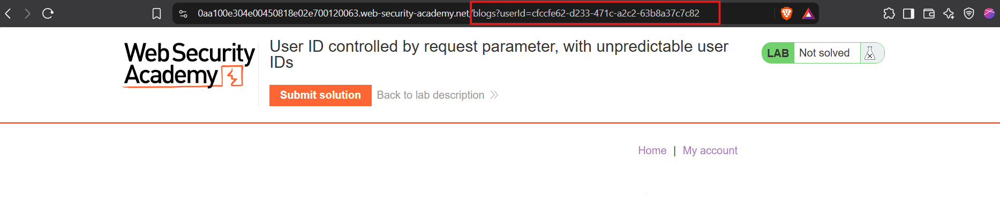
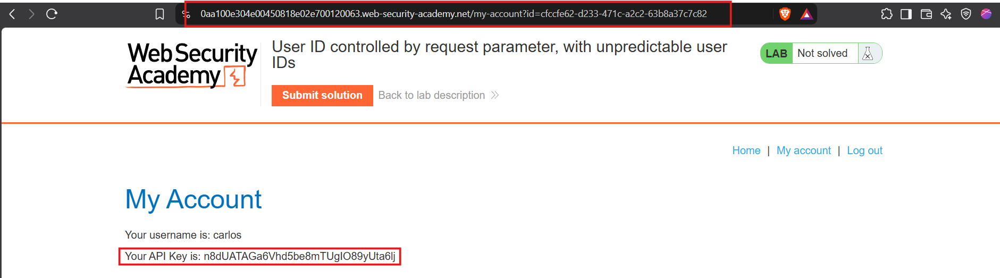
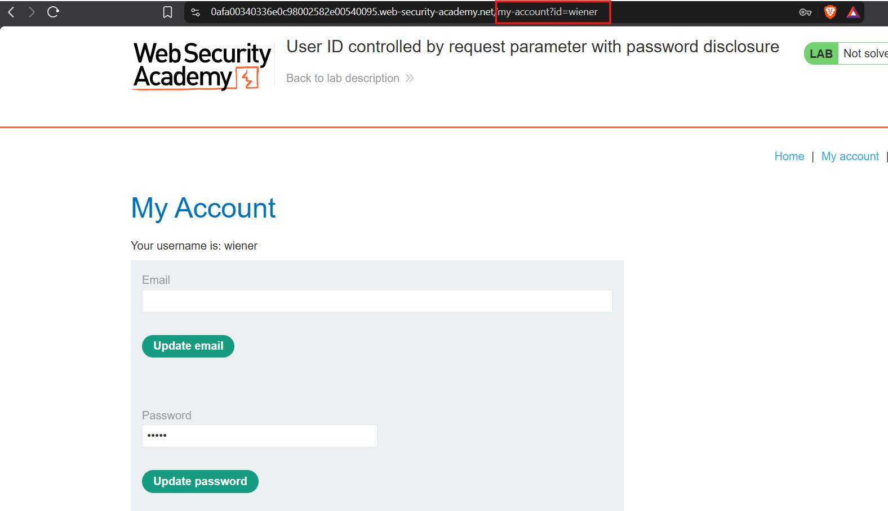
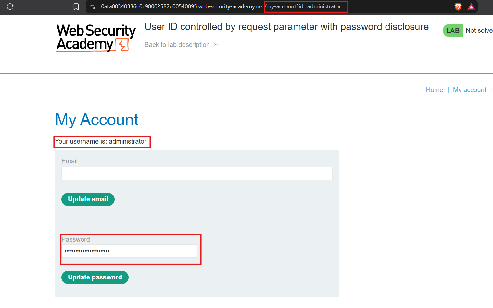
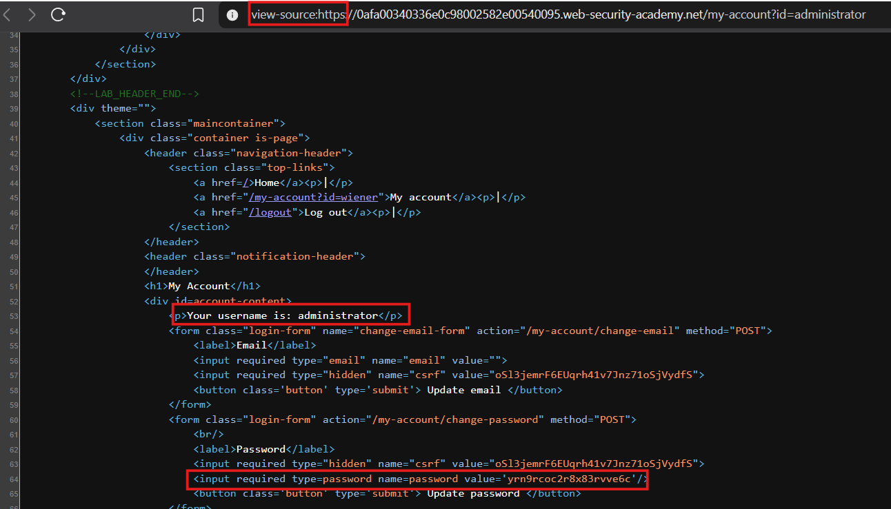

## Horizontal Privilege Escalation

Horizontal privilege escalation occurs when a user accesses another user's resources without authorization.

**Example:**

A user accesses their account using `?id=123`. Changing the ID to another user's ID may expose their account and data.

This is an example of **Insecure Direct Object Reference (IDOR)**, where user-controlled parameters directly reference resources without proper authorization checks.

User IDs may be predictable or exposed elsewhere in the application, even if they use unique identifiers (GUIDs).

## Lab

## Horizontal to Vertical Privilege Escalation

Horizontal privilege escalation can lead to vertical escalation if an attacker compromises a more privileged user's account.

For example, modifying `?id=123` to target an administrator may expose their account or enable password changes, granting access to administrative functionality.

## Lab

