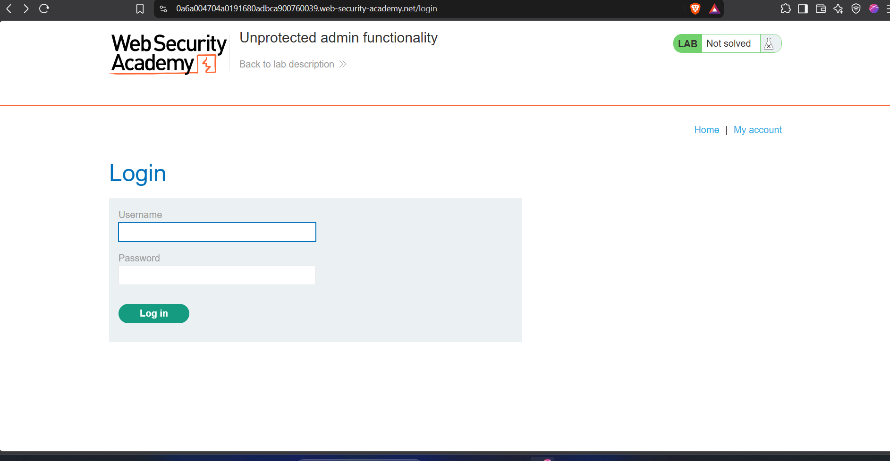
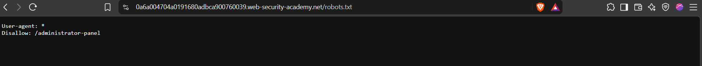
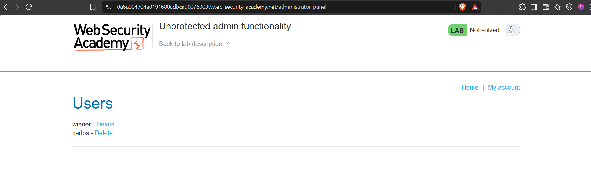
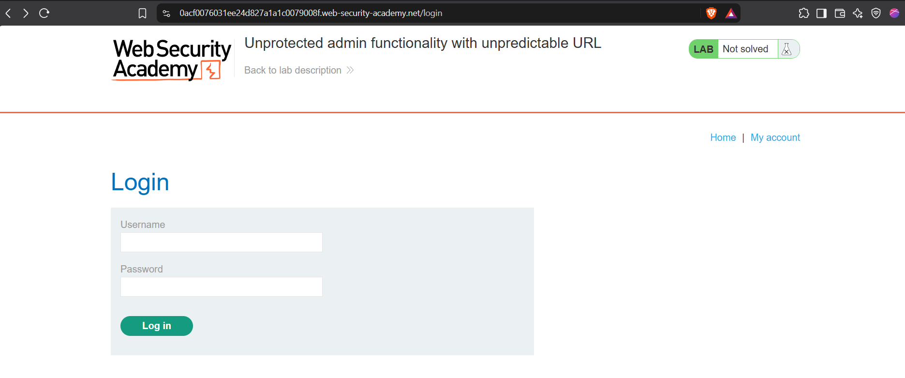
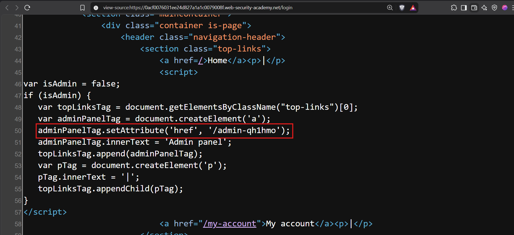
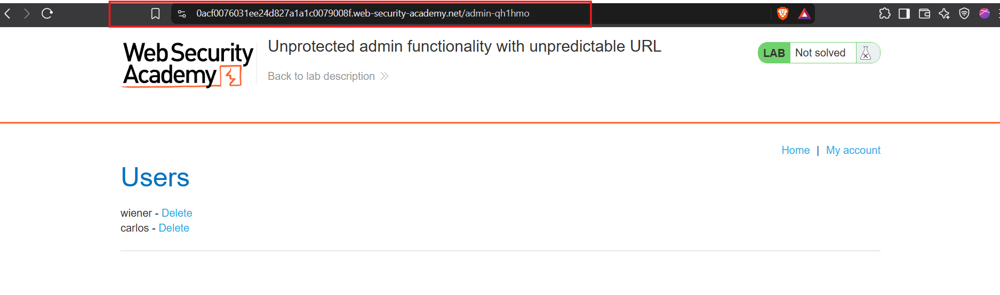
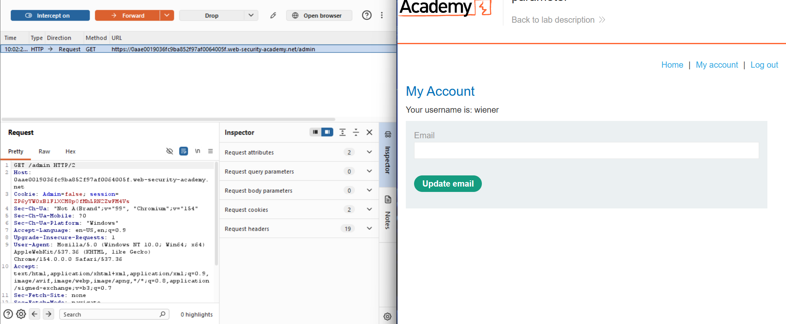
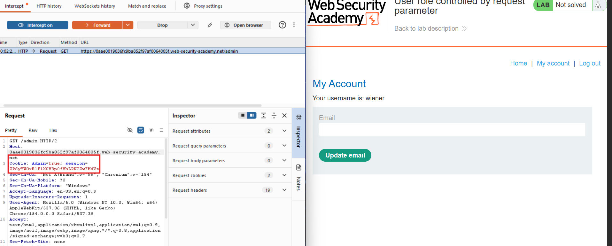
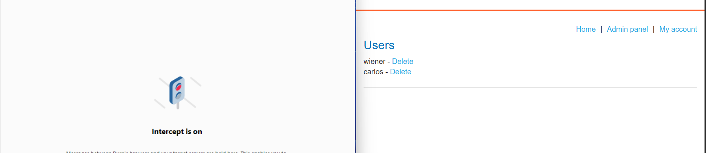

## Vertical Privilege Escalation

If a user gains access to functionality they are not authorized to access, this is vertical privilege escalation.

## Robots.txt (Robots Exclusion Protocol or REP)

A file that specifies which URLs web crawlers should or should not crawl.

## Unprotected Functionality

Sensitive admin URLs lack access controls, allowing unauthorized users to access them directly.

These URLs can be discovered through exposed paths or brute-forced using a wordlist.

## Lab

**1. Login Page**

**2. Access Robots.txt**

**3. Successful Exploitation**

## Unprotected Functionality - Continued

Hiding admin URLs (**security by obscurity**) is not effective access control.

Obfuscated URLs may still be discovered in client-side JavaScript, even if the admin link is hidden from ordinary users.

## Lab

**1. Login Page**

**2. Access Page Source**

**3. Successful Exploitation**

## Parameter-Based Access Control

Some applications store user roles in client-controllable locations, such as hidden fields, cookies, or URL parameters.

Attackers can modify these values to gain unauthorized access to privileged functionality.

**Examples:**
- `?admin=true`
- `?role=1`

## Lab

**1. Logged in as `wiener:peter`**

**2. Change Admin Value to `true`**

**3. Successful Exploitation**

