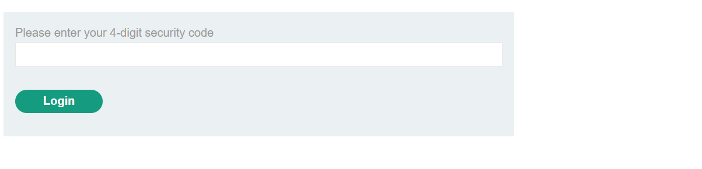

## Bypassing Two-Factor Authentication

A flawed implementation may grant access after password verification without properly enforcing the second authentication step. Test whether you can access authenticated pages directly before completing the verification code step.

## Lab

**Log in with `carlos:montoya`**

**Navigate back and forward to bypass 2FA**

